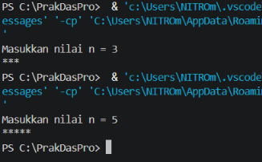
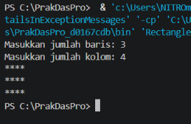
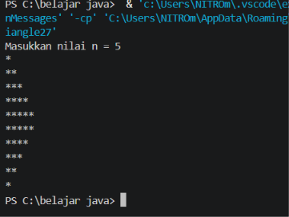
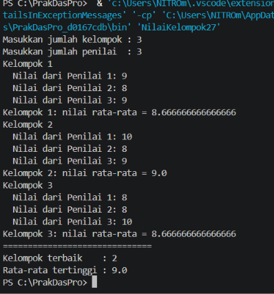
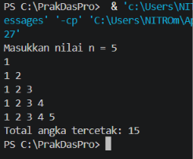
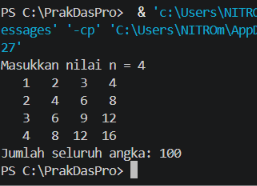
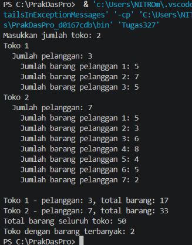

# Laporan Jobsheet 8 – Perulangan 2 (Nested Loop)

**Identitas Mahasiswa:**
* **Nama:** Subhan Akbar Mashuri
* **NIM:** 264107020214
* **Kelas / No. Presensi:** TI-1D / 27

---

## Tujuan

- Memahami konsep dan alur perulangan bersarang (*nested loop*).
- Mengenal sintaks perulangan bersarang dengan `for`, `while`, dan `do-while`.
- Menerapkan perulangan bersarang untuk menyelesaikan studi kasus sederhana.

---

## Percobaan 1 – Review Perulangan 1

**Penjelasan singkat:**
Percobaan ini mengulang konsep perulangan `for` tunggal. Program membaca bilangan bulat `n`, lalu mencetak karakter `*` sebanyak `n` kali secara mendatar. Digunakan `print` (bukan `println`) agar karakter tidak pindah baris, dan `println()` ditambahkan sekali setelah perulangan selesai.

**Kode (`StarNoAbsen.java`):**

```java
import java.util.Scanner;

public class Star27 {
    public static void main(String[] args) {
        Scanner sc = new Scanner(System.in);
        System.out.print("Masukkan nilai n = ");
        int n = sc.nextInt();

        for (int i = 1; i <= n; i++) {
            System.out.print("*");
        }
        System.out.println();
        sc.close();
    }
}
```

**Hasil pengujian:**



### Jawaban Pertanyaan

**1. Jika `i = 1` diubah menjadi `i = 0` (kondisi tetap `i <= n`), berapa `*` tercetak saat n = 5?**
Tercetak **6 bintang**. Nilai `i` berjalan 0, 1, 2, 3, 4, 5 (enam nilai) sehingga badan perulangan dijalankan 6 kali. Jumlah iterasi = (batas akhir − nilai awal) + 1 = (5 − 0) + 1 = 6.

**2. Jika kondisi `i <= n` diganti `i < n`, berapa kali perulangan dijalankan saat n = 5? Mengapa berbeda?**
Perulangan dijalankan **4 kali** (`i` = 1, 2, 3, 4). Operator `<` tidak menyertakan nilai `n` itu sendiri; ketika `i` bernilai 5, kondisi `5 < 5` bernilai *false* sehingga perulangan berhenti. Sebaliknya `<=` masih menjalankan iterasi saat `i == n`.

**3. Prediksi output untuk n = 9:**

```java
for (int i = 2; i <= n; i += 2) {
    System.out.print(i + " ");
}
```

Nilai `i` = 2, 4, 6, 8 (berikutnya 10 > 9, berhenti). Output: **`2 4 6 8`**

Modifikasi agar mencetak bilangan ganjil positif yang tidak melebihi n:

```java
import java.util.Scanner;

// Pertanyaan 3 (Percobaan 1): prediksi + modifikasi bilangan ganjil
public class StarGanjil14 {
    public static void main(String[] args) {
        Scanner sc = new Scanner(System.in);
        System.out.print("Masukkan nilai n = ");
        int n = sc.nextInt();

        // Kode soal: untuk n = 9 mencetak "2 4 6 8 "
        System.out.print("Bilangan genap: ");
        for (int i = 2; i <= n; i += 2) {
            System.out.print(i + " ");
        }
        System.out.println();

        // Modifikasi: bilangan ganjil positif <= n
        System.out.print("Bilangan ganjil: ");
        for (int i = 1; i <= n; i += 2) {
            System.out.print(i + " ");
        }
        System.out.println();
        sc.close();
    }
}
```

Untuk n = 9 outputnya `1 3 5 7 9`. Perubahannya hanya pada nilai awal (2 → 1), sedangkan langkah `i += 2` tetap.

**4. Mengapa `i++` diganti `i--` (kondisi tetap `i <= n`) membuat perulangan tidak berhenti dalam waktu wajar?**
Nilai awal `i = 1` lalu terus turun (0, −1, −2, …). Untuk n positif, kondisi `i <= n` selalu *true* karena `i` justru semakin menjauhi batas `n`; kondisi berhenti tidak pernah tercapai. Secara teknis `int` baru akan *overflow* (melompat dari nilai terkecil ke terbesar) setelah sekitar 4 miliar iterasi, sehingga program praktis seperti berjalan tanpa henti (*infinite loop*) dan terus mencetak `*`. Arah perubahan variabel kontrol harus mendekati kondisi berhenti.

---

## Percobaan 2 – Pola Bintang Persegi Panjang (Nested FOR)

**Penjelasan singkat:**
*Outer loop* mengatur **baris**, sedangkan *inner loop* mengatur **kolom** (analogi rak/loker: setiap rak/baris punya sejumlah loker/kolom). Untuk setiap satu iterasi *outer loop*, *inner loop* dijalankan penuh dari awal sampai akhir, lalu `println()` memindahkan kursor ke baris berikutnya.

**Kode (`RectangleNoAbsen.java`):**

```java
import java.util.Scanner;

public class Rectangle27 {
    public static void main(String[] args) {
        Scanner sc = new Scanner(System.in);
        System.out.print("Masukkan jumlah baris: ");
        int baris = sc.nextInt();
        System.out.print("Masukkan jumlah kolom: ");
        int kolom = sc.nextInt();

        for (int i = 1; i <= baris; i++) {          
            for (int j = 1; j <= kolom; j++) {      
                System.out.print("*");
            }
            System.out.println();                   
        }
        sc.close();
    }
}
```

**Hasil pengujian:**



### Jawaban Pertanyaan

**1. Fungsi variabel `i` dan `j`.**
`i` adalah variabel pencacah *outer loop* yang menghitung **nomor baris** yang sedang dicetak. `j` adalah variabel pencacah *inner loop* yang menghitung **nomor kolom (jumlah bintang)** pada baris tersebut.

**2. Untuk baris = 4 dan kolom = 7:**

| Bagian | Jumlah eksekusi |
|---|---|
| *Outer loop* (badan) | 4 kali |
| *Inner loop* (badan, total) | 4 × 7 = 28 kali (7 kali di setiap baris) |
| `print("*")` | 28 kali |

**3. Jika batas luar dan dalam ditukar (outer = `kolom`, inner = `baris`) dengan baris = 3, kolom = 6?**
*Outer loop* berjalan 6 kali dan setiap putarannya mencetak 3 bintang, sehingga hasilnya **6 baris × 3 bintang**:

```
***
***
***
***
***
***
```

Total bintang tetap 18 (3 × 6), tetapi bentuknya tertukar (tinggi 6, lebar 3) dan tidak sesuai dengan permintaan 3 baris × 6 kolom.

**4. Akibat menghapus `System.out.println();` setelah *inner loop*.**
Kursor tidak pernah pindah baris, sehingga seluruh bintang tercetak berderet dalam **satu baris panjang** (untuk 3 × 6: `******************`, 18 bintang). Bentuk persegi panjang tidak terbentuk.

**5. Modifikasi karakter menjadi `#`:**

```java
System.out.print("#");
```

---

## Percobaan 3 – Debugging Bintang Segitiga (Nested WHILE)

**Penjelasan singkat:**
Kode awal sengaja dibuat salah. Tugasnya mencari penyebab kesalahan dengan *debugging* (menampilkan nilai `i` di awal *outer loop*) lalu memperbaikinya tanpa mengganti `while` menjadi `for`. Setelah segitiga bertingkat benar, program diperluas dengan segitiga terbalik.

**Kode awal (salah):**

```java
int i = 0;
while (i <= n) {
    int j = 0;
    while (j < i) {
        System.out.print("*");
        j++;
    }
    i++;
}
```

**Output kode awal:** untuk n = 3 hanya `******` (6 bintang) dan untuk n = 5 hanya `***************` (15 bintang), semuanya dalam satu baris. Target yang benar adalah segitiga bertingkat.

**Output debug (n = 5):**
`[i=0] [i=1] *[i=2] **[i=3] ***[i=4] ****[i=5] *****`

**Kode akhir (`TriangleNoAbsen.java`):**

```java
import java.util.Scanner;

public class Triangle27 {
    public static void main(String[] args) {
        Scanner sc = new Scanner(System.in);
        System.out.print("Masukkan nilai n = ");
        int n = sc.nextInt();

        // Segitiga bertingkat
        int i = 1;                      // diperbaiki: mulai dari 1
        while (i <= n) {
            int j = 0;                  // reset j tiap baris
            while (j < i) {
                System.out.print("*");
                j++;
            }
            System.out.println();       // diperbaiki: pindah baris
            i++;
        }

        // Segitiga terbalik
        i = n;                          // tanpa 'int' karena i sudah dideklarasikan
        while (i >= 1) {
            int j = 0;
            while (j < i) {
                System.out.print("*");
                j++;
            }
            System.out.println();
            i--;
        }
        sc.close();
    }
}
```

**Hasil pengujian:**




### Jawaban Pertanyaan

**1. Ketidaksesuaian output awal dan minimal dua perbaikan.**
Ketidaksesuaian: (1) semua bintang tercetak dalam satu baris, dan (2) *outer loop* berjalan n + 1 kali sehingga ada iterasi `i = 0` yang tidak mencetak bintang. Perbaikan: (1) menambahkan `System.out.println();` setelah *inner loop* sebelum `i++`, dan (2) mengubah inisialisasi `i` dari 0 menjadi 1 (atau mengubah kondisi sehingga *outer loop* berjalan tepat n kali).

**2. Peran `i` dan `j`; mengapa `j` di-reset ke 0 setiap iterasi *outer loop*?**
`i` adalah penghitung baris (sekaligus jumlah bintang yang harus dicetak pada baris itu), dan `j` adalah penghitung bintang yang sudah dicetak pada baris tersebut. `j` harus kembali ke 0 agar setiap baris baru menghitung bintangnya dari awal. Jika tidak di-*reset*, `j` masih bernilai `i` dari baris sebelumnya; pada baris berikutnya hanya ada selisih 1 (`j = i − 1`) sehingga setiap baris hanya mencetak **1 bintang** dan pola segitiga tidak terbentuk (hanya kolom `*` satu per baris).

**3. Perubahan *outer loop* untuk segitiga terbalik.**

| Komponen | Segitiga bertingkat | Segitiga terbalik |
|---|---|---|
| Inisialisasi | `i = 1` | `i = n` |
| Kondisi | `i <= n` | `i >= 1` |
| Update | `i++` | `i--` |

---

## Percobaan 4 – Studi Kasus Nilai Tugas Proyek Kelompok

**Penjelasan singkat:**
Program menghitung rata-rata nilai setiap kelompok dari sejumlah penilai, lalu menentukan kelompok dengan rata-rata tertinggi. Menggunakan tiga tingkat perulangan: `while` (kelompok), `for` (penilai), dan `do-while` (validasi nilai 0–100). Validasi jumlah kelompok/penilai (harus > 0) memakai `if-else`.

**Kode (`NilaiKelompok27.java`):**

```java
import java.util.Scanner;

public class NilaiKelompok27 {
    public static void main(String[] args) {
        Scanner sc = new Scanner(System.in);

        System.out.print("Masukkan jumlah kelompok : ");
        int jumlahKelompok = sc.nextInt();
        System.out.print("Masukkan jumlah penilai  : ");
        int jumlahPenilai = sc.nextInt();

        if (jumlahKelompok <= 0 || jumlahPenilai <= 0) {
            System.out.println("Jumlah kelompok dan penilai harus > 0.");
        } else {
            int nomorKelompok = 1;
            double rataTertinggi = -1;
            int kelompokTerbaik = 0;

            while (nomorKelompok <= jumlahKelompok) {
                System.out.println("Kelompok " + nomorKelompok);
                double totalNilai = 0;

                for (int j = 1; j <= jumlahPenilai; j++) {
                    int nilai;
                    do {
                        System.out.print("  Nilai dari Penilai " + j + ": ");
                        nilai = sc.nextInt();
                        if (nilai < 0 || nilai > 100) {
                            System.out.println("  Nilai harus 0-100. Ulangi input!");
                        }
                    } while (nilai < 0 || nilai > 100);
                    totalNilai += nilai;
                }

                double rataNilai = totalNilai / jumlahPenilai;
                System.out.println("Kelompok " + nomorKelompok
                        + ": nilai rata-rata = " + rataNilai);

                if (rataNilai > rataTertinggi) {
                    rataTertinggi = rataNilai;
                    kelompokTerbaik = nomorKelompok;
                }
                nomorKelompok++;
            }

            System.out.println("==============================");
            System.out.println("Kelompok terbaik    : " + kelompokTerbaik);
            System.out.println("Rata-rata tertinggi : " + rataTertinggi);
        }
        sc.close();
    }
}
```

**Hasil pengujian:**



Input jumlah kelompok = 0 menghasilkan pesan `Jumlah kelompok dan penilai harus > 0.`

### Jawaban Pertanyaan

**1. Mengapa `totalNilai` perlu di-*reset* di dalam *outer loop*, tetapi `rataTertinggi` tidak?**
`totalNilai` adalah penampung nilai **satu kelompok**; bila tidak di-*reset*, nilai kelompok sebelumnya ikut terjumlah sehingga rata-rata salah. `rataTertinggi` adalah rekor **seluruh kelompok** yang harus bertahan agar bisa dibandingkan dengan kelompok berikutnya. Bila di-*reset* di setiap kelompok, kelompok yang terakhir diproses selalu dianggap terbaik.

**2. Untuk 3 kelompok dan 2 penilai (tanpa input salah), berapa kali badan `for` dijalankan?**
3 × 2 = **6 kali**.

**3. Apa yang terjadi jika `totalNilai` bertipe `int` dan rata-rata dihitung dengan pembagian dua bilangan bulat?**
Hasil pembagian dipotong (pecahannya hilang) karena pembagian `int / int` menghasilkan `int`. Contoh: nilai 85 dan 90, total = 175, `175 / 2` = **87** (bukan 87,5). Walaupun hasilnya disimpan ke `double`, nilainya sudah terpotong sebelum disimpan (menjadi 87.0). Solusinya: gunakan `double` untuk `totalNilai` atau casting `(double) totalNilai / jumlahPenilai`.

**4. Mengapa `rataTertinggi` diawali −1, bukan 0? Contoh input yang salah jika diawali 0.**
Nilai valid minimal 0, sehingga rata-rata terkecil yang mungkin adalah 0. Dengan nilai awal −1, kelompok pertama (berapa pun rata-ratanya, termasuk 0) selalu lebih besar dan pasti tercatat. Jika diawali 0, kondisi `rataNilai > rataTertinggi` tidak terpenuhi untuk rata-rata 0. Contoh: 2 kelompok, 2 penilai, semua nilai 0. Seluruh rata-rata 0.0 tidak pernah `> 0`, sehingga `kelompokTerbaik` tetap **0** (kelompok yang tidak ada), padahal seharusnya kelompok 1.

**5. Tiga tingkat perulangan dan perannya.**

| Tingkat | Jenis | Peran |
|---|---|---|
| Luar | `while` | Memproses kelompok satu per satu (dikendalikan `nomorKelompok`). |
| Tengah | `for` | Mengulang input untuk setiap penilai; jumlah iterasi sudah pasti (`jumlahPenilai`). |
| Dalam | `do-while` | Memvalidasi nilai; input diminta minimal sekali dan diulang selama nilai di luar 0–100. |

---

## Tugas

### Tugas 1 – Pola Bilangan Bertingkat (`Tugas1NoAbsen.java`)

**Penjelasan singkat:** *Outer loop* (`i`) mengatur baris 1 sampai n, *inner loop* (`j`) mencetak angka 1 sampai `i` pada setiap baris, dan variabel `total` bertambah setiap angka dicetak.

```java
import java.util.Scanner;

public class Tugas127 {
    public static void main(String[] args) {
        Scanner sc = new Scanner(System.in);
        System.out.print("Masukkan nilai n = ");
        int n = sc.nextInt();

        if (n < 1) {
            System.out.println("Nilai n minimal 1.");
        } else {
            int total = 0;
            for (int i = 1; i <= n; i++) {
                for (int j = 1; j <= i; j++) {
                    System.out.print(j);
                    if (j < i) {
                        System.out.print(" ");
                    }
                    total++;
                }
                System.out.println();
            }
            System.out.println("Total angka tercetak: " + total);
        }
        sc.close();
    }
}
```

**Hasil pengujian:**




Total angka = 1 + 2 + … + n = n(n + 1) / 2 = 15.

### Tugas 2 – Tabel Perkalian (`Tugas2NoAbsen.java`)

**Penjelasan singkat:** *Outer loop* mewakili nomor baris dan *inner loop* mewakili nomor kolom. Setiap sel berisi `i * j` yang dicetak rata kanan dengan `printf("%4d")`, lalu semua hasil dijumlahkan ke variabel `jumlah`.

```java
import java.util.Scanner;

public class Tugas227 {
    public static void main(String[] args) {
        Scanner sc = new Scanner(System.in);
        System.out.print("Masukkan nilai n = ");
        int n = sc.nextInt();

        if (n < 3) {
            System.out.println("Nilai n minimal 3.");
        } else {
            int jumlah = 0;
            for (int i = 1; i <= n; i++) {
                for (int j = 1; j <= n; j++) {
                    int hasil = i * j;
                    System.out.printf("%4d", hasil);
                    jumlah += hasil;
                }
                System.out.println();
            }
            System.out.println("Jumlah seluruh angka: " + jumlah);
        }
        sc.close();
    }
}
```

**Hasil pengujian:**




### Tugas 3 – Rekap Penjualan Beberapa Toko (`Tugas3NoAbsen.java`)

**Penjelasan singkat:** *Outer loop* memproses tiap toko, *inner loop* memproses tiap pelanggan dalam toko itu. Data tidak disimpan satu per satu, cukup diakumulasikan ke `totalBarangToko` dan `totalSemuaBarang`. Input negatif divalidasi dengan `do-while`. Toko terbanyak dicari dengan operator `>` dan nilai awal −1, sehingga bila nilai tertinggi sama maka toko bernomor kecil tetap terpilih.

```java
import java.util.Scanner;

public class Tugas327 {
    public static void main(String[] args) {
        Scanner sc = new Scanner(System.in);

        System.out.print("Masukkan jumlah toko: ");
        int jumlahToko = sc.nextInt();

        if (jumlahToko < 1) {
            System.out.println("Jumlah toko minimal 1.");
        } else {
            int totalSemuaBarang = 0;
            int barangTerbanyak = -1;
            int tokoTerbanyak = 0;
            String ringkasan = "";

            for (int t = 1; t <= jumlahToko; t++) {
                System.out.println("Toko " + t);

                int jumlahPelanggan;
                do {
                    System.out.print("  Jumlah pelanggan: ");
                    jumlahPelanggan = sc.nextInt();
                    if (jumlahPelanggan < 0) {
                        System.out.println("  Tidak boleh negatif. Ulangi input!");
                    }
                } while (jumlahPelanggan < 0);

                int totalBarangToko = 0;
                for (int p = 1; p <= jumlahPelanggan; p++) {
                    int barang;
                    do {
                        System.out.print("    Jumlah barang pelanggan " + p + ": ");
                        barang = sc.nextInt();
                        if (barang < 0) {
                            System.out.println("    Tidak boleh negatif. Ulangi input!");
                        }
                    } while (barang < 0);
                    totalBarangToko += barang;
                }

                ringkasan += "Toko " + t + " - pelanggan: " + jumlahPelanggan
                        + ", total barang: " + totalBarangToko + "\n";
                totalSemuaBarang += totalBarangToko;

                if (totalBarangToko > barangTerbanyak) {
                    barangTerbanyak = totalBarangToko;
                    tokoTerbanyak = t;
                }
            }

            System.out.println();
            System.out.print(ringkasan);
            System.out.println("Total barang seluruh toko: " + totalSemuaBarang);
            System.out.println("Toko dengan barang terbanyak: " + tokoTerbanyak);
        }
        sc.close();
    }
}
```

**Hasil pengujian:**




---

## Kesimpulan

1. **Perulangan bersarang** adalah perulangan di dalam perulangan. Untuk setiap satu iterasi *outer loop*, *inner loop* dijalankan penuh dari awal sampai selesai, sehingga total iterasi dalam = jumlah iterasi luar × jumlah iterasi dalam (contoh 4 × 7 = 28).
2. Pada pola dua dimensi, *outer loop* umumnya mengatur **baris** dan *inner loop* mengatur **kolom**. Menukar batas keduanya mengubah bentuk output, dan `println()` di akhir *inner loop* menentukan perpindahan baris.
3. Batas *inner loop* boleh bergantung pada variabel *outer loop* (misalnya `j < i`), yang menghasilkan pola segitiga. Variabel pencacah *inner loop* harus di-*reset* di setiap iterasi *outer loop*.
4. Kesalahan yang sering muncul adalah *off-by-one* (nilai awal atau operator `<` dan `<=` yang keliru), lupa `println()`, lupa *reset* variabel, dan perulangan tak berhenti karena arah perubahan variabel kontrol salah. Teknik *debugging* sederhana dengan mencetak nilai variabel sangat membantu menemukannya.
5. Jenis perulangan dipilih sesuai kebutuhan: `for` untuk jumlah iterasi yang sudah pasti, `while` untuk perulangan berbasis kondisi, dan `do-while` untuk perintah yang harus dijalankan minimal sekali, seperti validasi input.
6. Variabel yang harus bertahan antar-iterasi (akumulator dan rekor seperti `rataTertinggi`) dideklarasikan **di luar** perulangan, sedangkan variabel yang hanya berlaku per putaran (seperti `totalNilai` per kelompok) di-*reset* di dalam *outer loop*. Dengan akumulasi ini, data tidak perlu disimpan satu per satu.